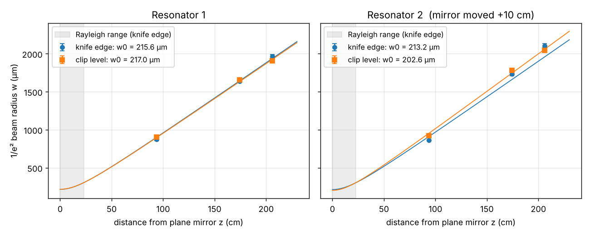
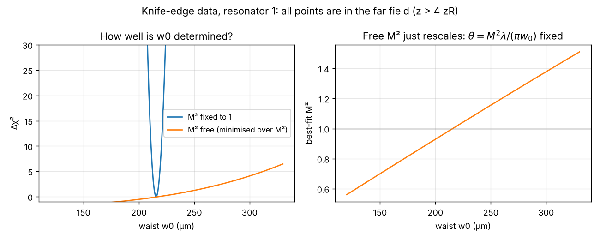
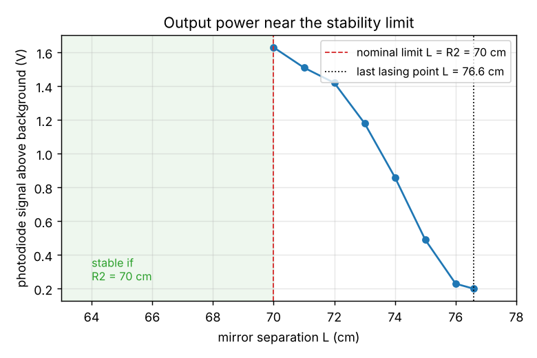
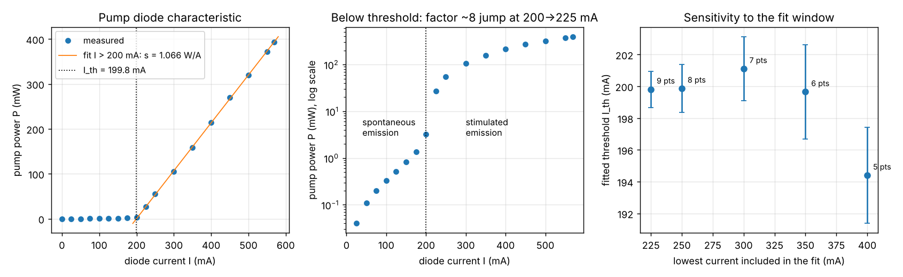
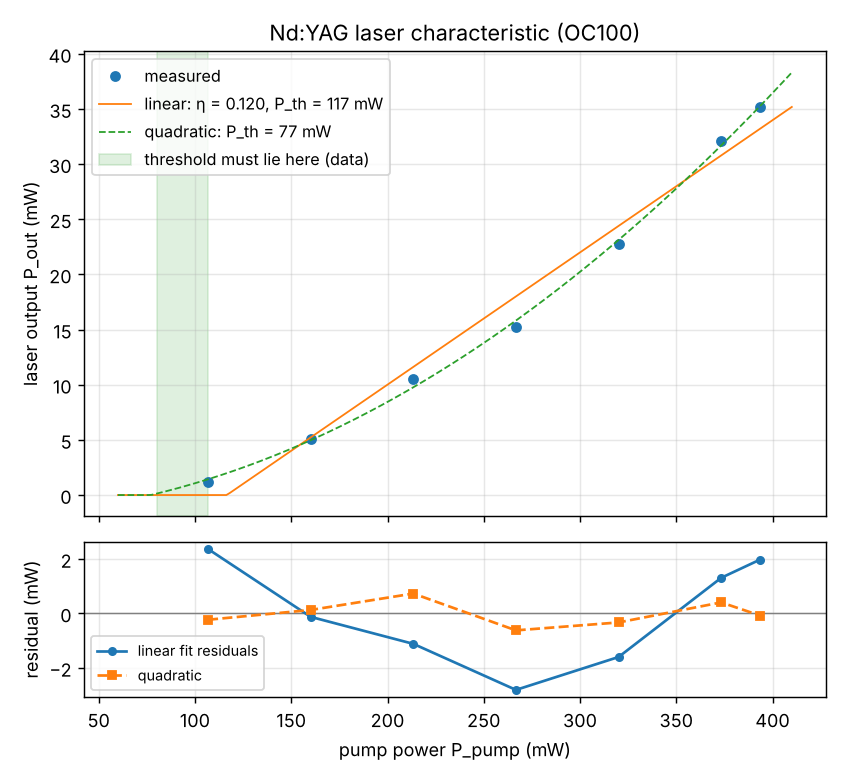
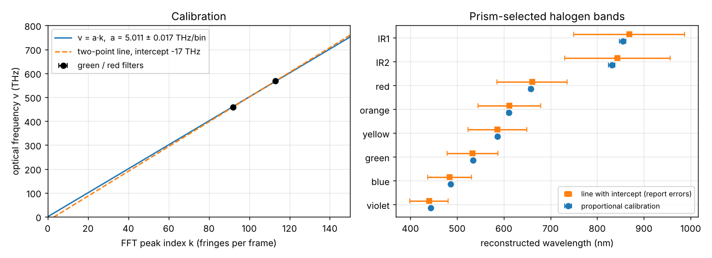
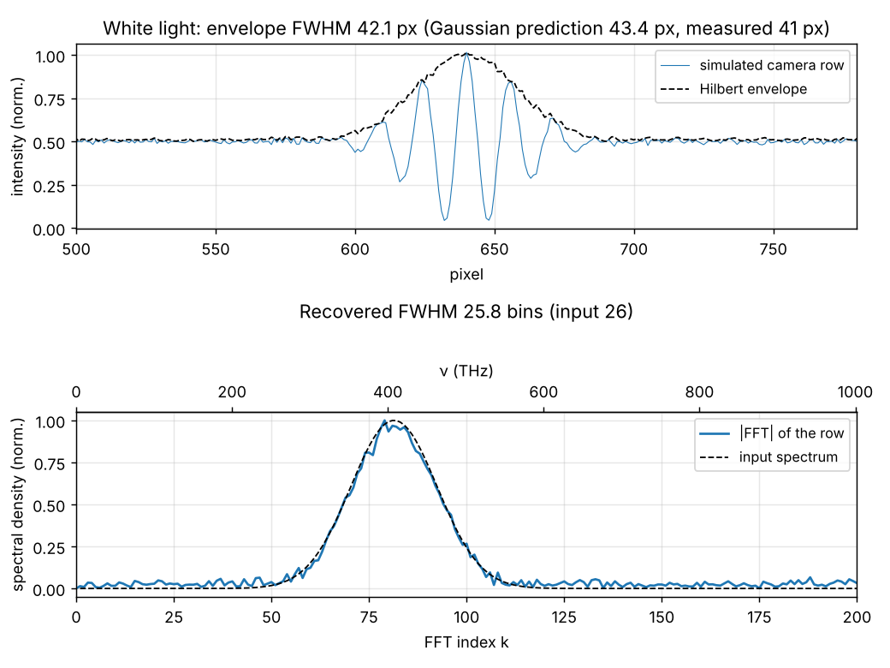
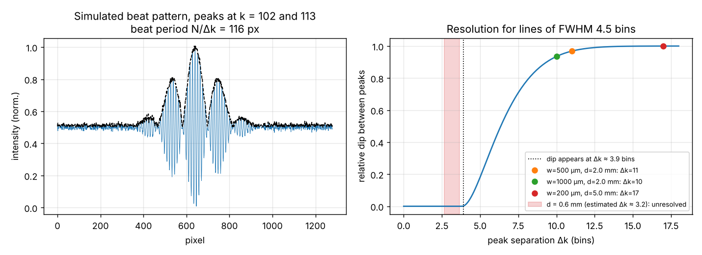

# Laser and optics lab data, re-analysed

Analysis code for three experiments from the Advanced Physics Lab at FAU Erlangen-Nürnberg: a HeNe laser, a diode-pumped Nd:YAG laser, and a Michelson interferometer used as a Fourier-transform spectrometer.

The measured values come from the tables of my lab reports ([data/](data/README.md)). Going back to them with more careful statistics changed several conclusions. Mostly it changed how much the numbers can actually be trusted: some quoted errors were too small, and some were too large by a factor of ten or more.

```
optics/      reusable code: Gaussian beam relations, fitting helpers, FFT spectroscopy
analysis/    one script per experiment, writes figures/ and results/
data/        measured values (CSV)
tests/       pytest checks
```

## 1. Gaussian beam of a HeNe laser

The 1/e² beam radius was measured at three distances, with two methods, for two resonator lengths (the spherical mirror was moved by 10 cm). Fitting w(z) = w0 √(1 + (z/zR)²) with the waist on the plane mirror gives the waist w0, the Rayleigh length zR and the divergence θ.



| Resonator | Method | w0 (µm) | χ²/dof | zR (cm) | θ (mrad) |
|---|---|---|---|---|---|
| 1 | knife edge | 215.6 ± 2.1 | 1.9 | 23.1 | 0.934 |
| 1 | clip level | 217.0 ± 1.9 | 1.0 | 23.4 | 0.928 |
| 2 | knife edge | 213.2 ± 9.0 | 40 | 22.6 | 0.945 |
| 2 | clip level | 202.6 ± 2.4 | 2.2 | 20.4 | 0.994 |

Errors are scaled by √(χ²/dof) where χ²/dof > 1.

**What the re-analysis shows**

- **Resonator 1:** the two methods agree within 1σ.
- **Resonator 2, knife edge:** the points do not lie on any Gaussian-beam curve within their quoted errors (χ²/dof = 40). The quoted errors only contain the fit uncertainty of each scan, not systematic effects such as distance and alignment errors. The original report fitted without weights and got 202.8 ± 5.3 µm. With weights the result moves to 213 µm. A result that shifts by 2σ depending on the weighting is not well determined.
- **Change between resonators:** the expected shrinking of the waist when the mirror moves towards the stability limit is clearly seen with the clip-level method (217 → 203 µm), but the knife-edge data alone cannot confirm it.

**Far-field limitation:** all measuring points lie at z > 4 zR, where the beam already expands linearly. There the data only fix the divergence θ = M²λ/(πw0). The waist follows only by assuming an ideal TEM00 beam (M² = 1). If M² is left free, w0 is no longer determined at all:



To measure w0 and M² separately, at least one point within the Rayleigh range (here z < 20 cm) would be needed.

**Resonator stability:** with a plane and a spherical mirror (nominal R2 = 70 cm) the resonator should become unstable at L = R2. The laser still oscillated at L = 76.6 cm, so the real radius of curvature is at least 76.6 cm, about 9 % above the specification.



## 2. Nd:YAG laser: threshold and slope efficiency

**Pump diode:** above threshold the optical power is linear in the current. A straight-line fit gives slope s = 1.066 ± 0.005 W/A and threshold I_th = 199.8 mA.



- **Threshold error:** the threshold is −b/s, and the slope and intercept of a line far from x = 0 are strongly anti-correlated. Ignoring that correlation (as in the report) gives ±2.3 mA. Fitting the threshold directly, P = s(I − I_th), or propagating with the full covariance gives **±1.1 mA**. A residual bootstrap agrees (68 % interval 198.8 to 200.8 mA).
- **Fit window:** the result is stable as long as the fit starts at or below 350 mA (right panel).

**Laser characteristic:** output vs. pump power, with the pump power taken from the diode calibration above.



- **Linear fit:** slope efficiency η = 0.120 ± 0.008 and threshold P_th = 116.5 ± 11.9 mW. The pump-calibration error contributes only 0.8 mW once its covariance is used. The report's ±20.7 mW was dominated by treating s and b as independent.
- **But the linear model is wrong here,** for two reasons:
  - The residuals have a clear pattern (+ − − − − + +), so the curve bends upwards.
  - The fitted threshold of 116.5 mW lies *above* the lowest point where the laser was actually running (106.8 mW). That is impossible.
- **What the data allow:** a quadratic follows the points and gives 77 mW, slightly below the highest pump power without lasing (80.2 mW). With seven points neither model pins the threshold down. The measurement itself brackets it: **between 80 and 107 mW**.

## 3. Michelson interferometer as a Fourier-transform spectrometer

With one mirror tilted, the path difference grows linearly across the camera. Each optical frequency then appears as a cosine fringe, and the FFT of one camera row is the spectrum. The FFT bin index k counts fringes per frame and is proportional to the optical frequency.

**Calibration:** the report calibrated with a straight line, ν = m·k + c, through the two filter points (528 nm and 653 nm). Two points and two parameters leave no degrees of freedom, and the report's intercept came out at −20 THz ± 39 THz. This uncertainty was then propagated into every wavelength (±41 to ±119 nm).

Physically the intercept must be zero: zero fringes means zero frequency. The report itself uses that assumption when it converts pixels to mirror displacement. Fitting ν = a·k gives a = 5.011 ± 0.017 THz/bin, with χ² = 0.97 for one degree of freedom, so the two filters agree. The wavelength errors drop by a factor of about 18:



| band | k | λ (nm), proportional | report error (nm) |
|---|---|---|---|
| violet | 135 | 443.2 ± 2.2 | ± 41.3 |
| green | 112 | 534.2 ± 3.0 | ± 54.4 |
| red | 91 | 657.5 ± 4.3 | ± 75.6 |
| IR1 | 70 | 854.7 ± 6.8 | ± 118.6 |

(all eight bands in [results/fourier_spectroscopy.md](results/fourier_spectroscopy.md))

- **Independent check:** the calibration implies an optical path difference of 46.74 nm per pixel, i.e. 23.37 nm of mirror travel. The report measured 23.4 nm per pixel separately.
- **White light:** the measured spectral width (26 bins) and the measured fringe-envelope width (41 px) are Fourier partners. For a Gaussian spectrum their product is fixed, 4 ln2·N/π, which predicts 43.4 px from the spectral width. The measurement is within 6 %, so the two coherence-length estimates in the report are consistent. The envelope gives a coherence length of 1.9 µm.

The camera images were not kept, so the processing chain is shown on an interferogram simulated with the measured spectrum (Gaussian, centred at 735 nm, FWHM 26 bins, 1 % noise). The FFT recovers the input width (25.8 bins), and the Hilbert envelope gives 42 px:



**Double slit:** two slits behind the prism pass two narrow bands, which show up as beats in the interferogram and as two peaks in the spectrum. Two lines of the measured width (about 4.5 bins) only separate once their distance exceeds 3.9 bins. Scaling the measured 2 mm spacing to a 0.6 mm gap gives about 3.2 bins. That explains why the 0.6 mm double slits were not resolved:



## Running it

```bash
pip install -r requirements.txt
python analysis/gaussian_beam.py
python analysis/ndyag_laser.py
python analysis/fourier_spectroscopy.py
pytest
```

Each script prints its results and writes them to `results/`, along with the figures in `figures/`.

## Limitations

- Only the processed tables survived, not the raw scans and images. Where the raw signal matters (the knife-edge curves, the interferograms), it is simulated from measured parameters and labelled as such.
- The ±0.5 bin peak-position error in the spectrometer calibration is an assumption (peak read to the nearest FFT bin). The calibration χ² supports it, but with only two calibration lines that check is weak.
- The 0.6 mm double-slit spacing is extrapolated linearly from the 2 mm data. The prism dispersion is not linear, so this is an estimate.

## References

- O. Svelto, *Principles of Lasers*, 5th ed., Springer, 2010: Gaussian beams, resonator stability, laser threshold.
- ISO 11146-1: beam width measurement (knife edge, clip level).
- R. J. Bell, *Introductory Fourier Transform Spectroscopy*, Academic Press, 1972.
- FAU Advanced Lab Course instructions B01 (Michelson interferometer), B49 (Nd:YAG laser), B50 (HeNe laser).
